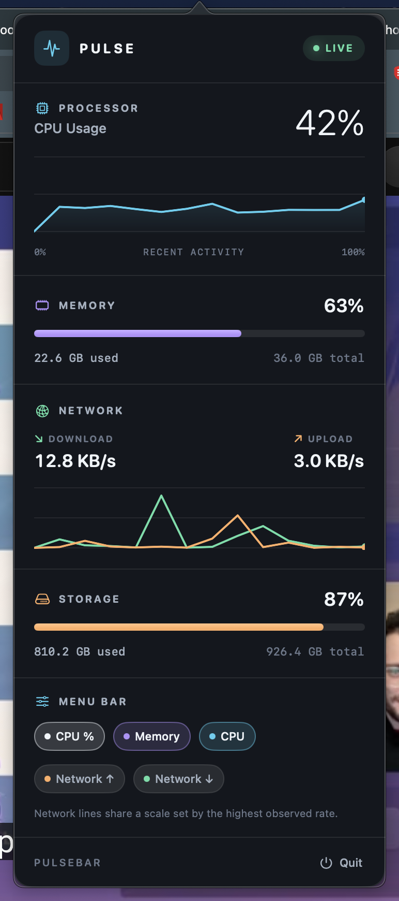

# PulseBar

**A tiny, beautiful system monitor for your macOS menu bar.**

PulseBar keeps CPU and memory activity in view with two live sparklines. Click the graph to open a dark, compact dashboard with CPU history, memory, network traffic, and storage usage. It is built with AppKit and SwiftUI, has no external dependencies, and runs without a Dock icon.



## Highlights

- **At-a-glance activity:** teal CPU and purple memory sparklines, plus a live CPU percentage.
- **Make it yours:** toggle the CPU percentage and each CPU, memory, download (green), and upload (orange) graph line independently in the **MENU BAR** controls. Your choices persist across launches.
- **A meaningful scale:** CPU and memory use a subtle 0%, 50%, and 100% backdrop. Network lines share a scale set by the highest rate seen since launch; hover for exact current readings.
- **Click for detail:** CPU history, memory usage, upload/download rates and history, and root-volume capacity.
- **Lightweight and native:** one-second sampling, a 60-sample rolling history, an AppKit menu-bar item, and a SwiftUI popover.
- **Private by design:** metrics are collected locally. No account, analytics, network requests, or third-party packages.

## Requirements

macOS 13 or later and the Swift Command Line Tools (`xcode-select --install`). Full Xcode is not required. The build script targets the current Mac's architecture (Apple silicon or Intel).

## Install from source

```sh
git clone https://github.com/aaronik/PulseBar.git
cd PulseBar
./build.sh
open -g build/PulseBar.app
```

PulseBar appears at the right side of the menu bar. Click its graph to open or close the dashboard; click **Quit** in the dashboard to exit. It does not add a Dock icon.

For a permanent installation, move `build/PulseBar.app` to `/Applications` and launch that copy. To start it when you log in, add the installed app in **System Settings → General → Login Items**. Rebuild and replace the installed copy when updating.

> This project currently distributes source code, not a notarized binary. `build.sh` applies an ad-hoc signature to the locally built app.

## Development and checks

```sh
swift build
./build.sh
swiftc -swift-version 6 -target "$(uname -m)-apple-macosx13.0" \
  Sources/PulseBar/Metrics.swift Sources/PulseBar/DisplaySettings.swift \
  Tests/Smoke.swift -o /tmp/pulsebar-smoke
/tmp/pulsebar-smoke
```

The smoke test takes real samples and checks that metrics are bounded, network rates are nonnegative, and the sampler starts/stops correctly. Full Xcode is needed for XCTest; the standalone smoke test works with Command Line Tools alone.

## How it works

| Metric | Source |
| --- | --- |
| CPU | Delta of Mach host CPU ticks (idle versus total) |
| Memory | Physical RAM minus free and inactive VM pages |
| Network | Byte-counter deltas for active, non-loopback interfaces |
| Storage | Root volume capacity and available space |

Readings update every second. Memory usage is an approximation, **not** Activity Monitor's memory-pressure score. Network traffic through virtual/tunnel interfaces can be counted more than once. Graph history lasts about a minute and resets on restart.

## License

MIT — see [LICENSE](LICENSE).
